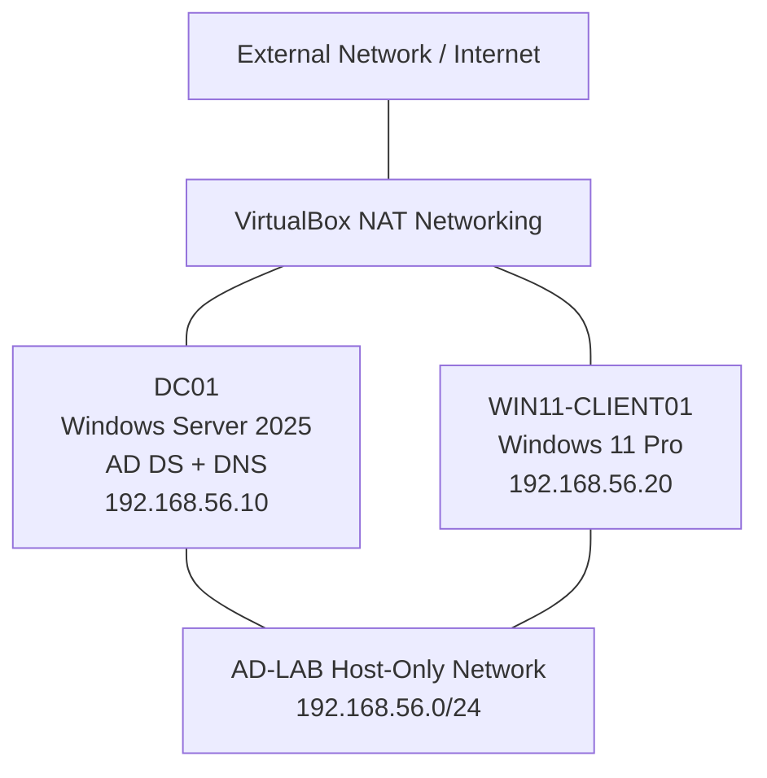

# Active Directory Lab Network Architecture

## Network Details

- **Domain:** adlab.test
- **Domain Controller:** DC01
- **DNS Server:** 192.168.56.10
- **Windows 11 Client:** 192.168.56.20
- **Internal Network:** AD-LAB (Host-Only)
- **Outbound Connectivity:** VirtualBox NAT
